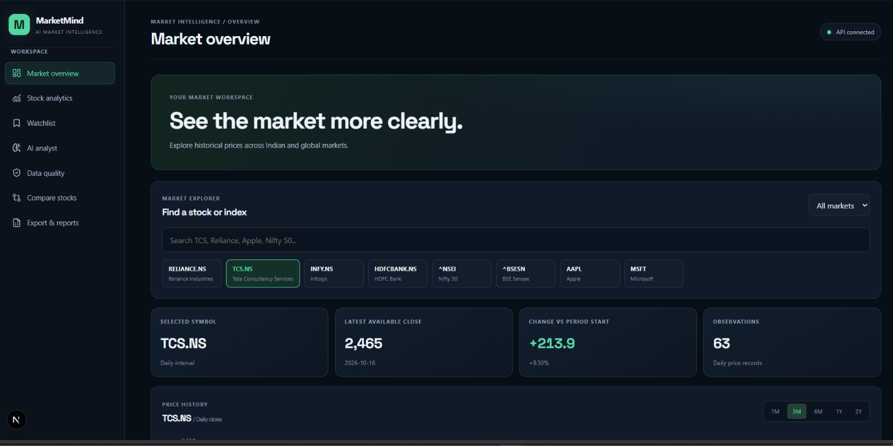
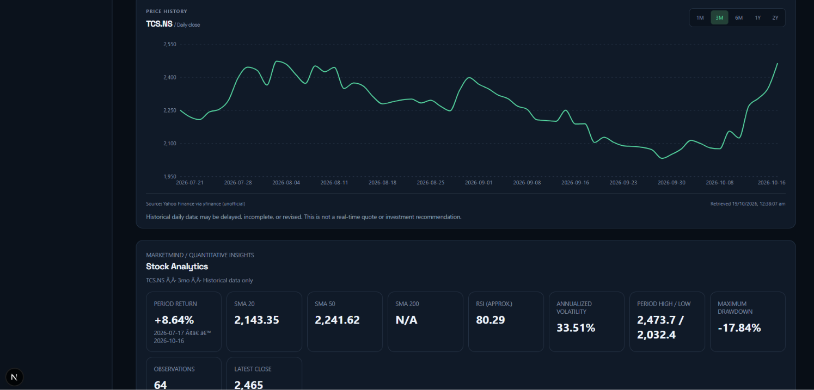
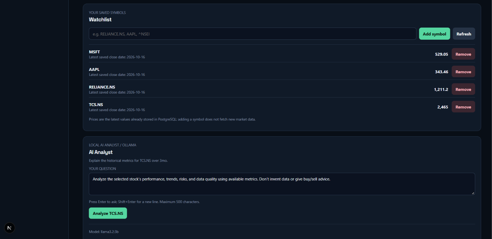
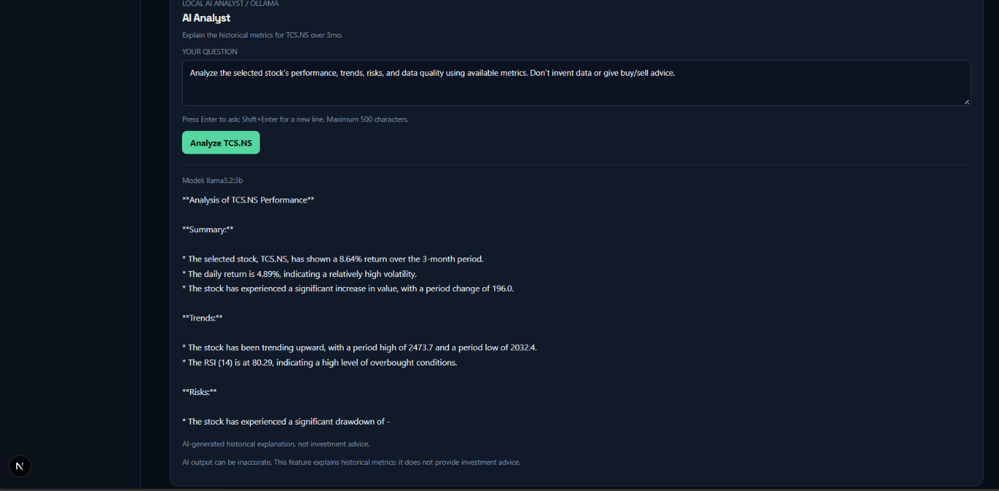
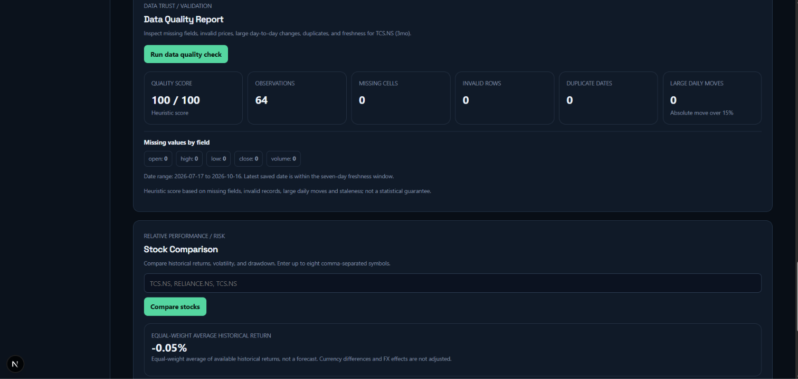
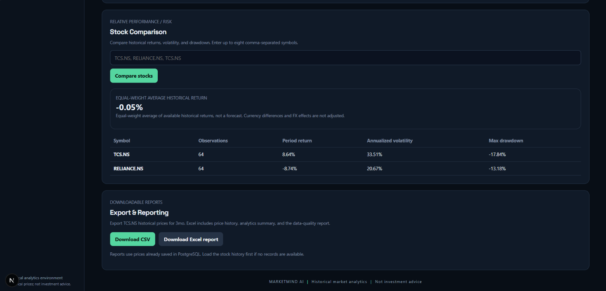

# MarketMind AI

**An end-to-end financial data analytics platform built with Python, SQL, and AI-assisted analysis.**

MarketMind AI brings historical market data, quantitative metrics, data-quality validation, stock comparison, watchlist management, and downloadable reports into one dashboard. A locally hosted Ollama model explains available metrics in plain language.

> **Scope:** Educational analysis of historical financial data. MarketMind AI is not a trading system, does not guarantee real-time quotes, and does not provide investment advice.

<p>
  
  
  
  
  
</p>

## Overview

The project demonstrates a complete analytics workflow: retrieve historical prices, store data in PostgreSQL, calculate metrics, validate the data, compare instruments, and export results for further analysis.

## Features

| Area | Capabilities |
|---|---|
| Market explorer | Built-in Indian and global ticker list, historical price charts, selectable periods |
| Stock analytics | Period return, moving averages, RSI, volatility, price range, maximum drawdown |
| Watchlist | Persistent saved symbols and display of latest stored prices |
| AI Analyst | Natural-language explanations using a local Ollama model and available historical metrics |
| Data quality | Missing fields, invalid rows, duplicate dates, large price moves, freshness checks |
| Stock comparison | Historical return, volatility, and drawdown comparison for multiple symbols |
| Reports | CSV export and Excel workbook with price history, quality results, and analytics summary |

## Screenshots

### Market overview

<p align="center">
  
</p>

### Price history and analytics

<p align="center">
  
</p>

### Watchlist and AI Analyst

<p align="center">
  
</p>

### AI Analyst response

<p align="center">
  
</p>

### Data-quality report

<p align="center">
  
</p>

### Stock comparison and export

<p align="center">
  
</p>

## Technology stack

| Layer | Tools |
|---|---|
| Frontend | Next.js, React, TypeScript, Recharts, Lucide React |
| Backend | Python, FastAPI |
| Database | PostgreSQL, SQLAlchemy |
| Historical market data | yfinance |
| Local AI | Ollama, `llama3.2:3b` |
| Reporting | CSV, openpyxl, Excel |
| Verification | Python `unittest`, TypeScript, Next.js production build |

## Architecture

The dashboard sends requests to FastAPI. The backend reads or updates saved price history in PostgreSQL, calculates analytics and data-quality results, and prepares exports. The AI Analyst sends a question and available historical metrics to the local Ollama service.

See [the architecture guide](docs/ARCHITECTURE.md) for the component responsibilities, endpoints, and limitations.

## Run locally on Windows

### Prerequisites

- Python 3.12 or a version compatible with the backend requirements
- Node.js and npm
- Docker Desktop with Docker Compose
- Ollama for local AI analysis

### 1. Configure environment files

Run these commands from the repository root:

```powershell
Copy-Item .env.example .env
Copy-Item backend\.env.example backend\.env
Copy-Item frontend\.env.example frontend\.env.local
```

Review the templates and configure your local database URL and frontend API URL as needed. Keep real `.env` files private; commit only example files with placeholders.

### 2. Start PostgreSQL

```powershell
docker compose up -d db
```

Make sure the database host, port, database name, username, and password in `backend\.env` match your local Compose configuration.

### 3. Install backend dependencies and start FastAPI

```powershell
Set-Location .\backend
python -m venv .venv
.\.venv\Scripts\Activate.ps1
python -m pip install -r requirements.txt
python -m uvicorn app.main:app --reload --host 127.0.0.1 --port 8000
```

If `.venv` already exists, reuse it. API documentation is available at `http://127.0.0.1:8000/docs`.

### 4. Start Ollama

In another terminal, ensure Ollama is running and the configured model is installed:

```powershell
ollama pull llama3.2:3b
```

The first AI request may take longer while the model loads.

### 5. Start the frontend

Open a separate terminal:

```powershell
Set-Location .\frontend
npm ci
npm run dev
```

Open `http://localhost:3000`. The frontend API URL can be configured using `NEXT_PUBLIC_MARKETMIND_API_URL`.

## Tests and quality checks

Run from the repository root:

```powershell
Set-Location .\backend
.\.venv\Scripts\python.exe -m py_compile .\app\main.py .\app\api\features.py .\app\api\pro_features.py
.\.venv\Scripts\python.exe -m unittest discover -s tests -v
```

Then check the frontend:

```powershell
Set-Location ..\frontend
.\node_modules\.bin\tsc.cmd --noEmit
npm run build
```

Stop a running Next.js development server before a production build if it is holding a lock on the `.next` directory.

## Important limitations

- yfinance is an unofficial data interface. Historical records may be delayed, incomplete, revised, or unavailable.
- The built-in search list is a starter symbol list, not an exhaustive market-wide screener.
- The data-quality score is a heuristic, not a guarantee that all data is correct.
- Large price movements are review flags, not proof of bad data.
- Cross-market comparisons do not automatically adjust for currency conversion or foreign-exchange effects.
- AI explanations may contain mistakes; verify statements against calculated metrics and source data.
- Local Ollama is not automatically accessible to a cloud deployment. An online deployment requires a separately deployed and secured backend, database, and AI strategy.

## Repository structure

```text
MarketMind_AI/
|-- backend/
|   |-- app/
|   |   |-- api/
|   |   |-- core/
|   |-- tests/
|-- frontend/
|   |-- src/
|       |-- app/
|       |-- components/
|       |-- lib/
|-- docs/
|   |-- screenshots/
|   |-- ARCHITECTURE.md
|-- docker-compose.yml
|-- .env.example
|-- README.md
```

## Project purpose

MarketMind AI is a portfolio project demonstrating data ingestion, relational storage, analytics calculations, validation, visualization, API integration, reporting, and AI-assisted explanation in one application.
