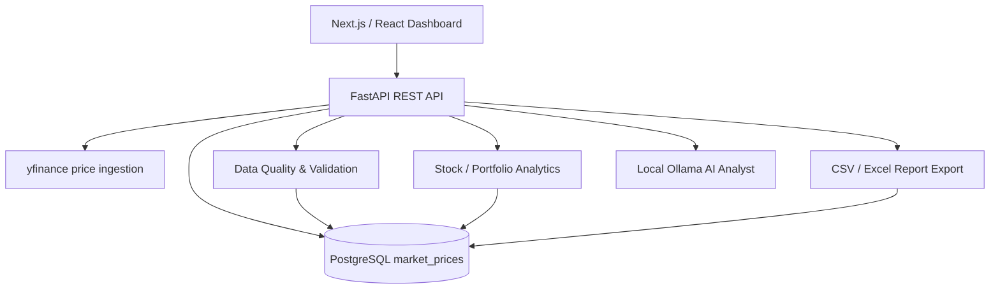

# MarketMind AI — Architecture

## Data flow

1. The market-history route retrieves daily prices and saves them to PostgreSQL.
2. Analytics, comparison, validation, and export routes read the saved history.
3. The frontend requests these endpoints and presents the results.
4. The local AI Analyst explains supplied historical metrics. It does not guarantee live-news access or future performance.

## Added endpoints

- `GET /api/v1/pro/quality/{symbol}?period=1y`
- `GET /api/v1/pro/compare?symbols=TCS.NS,RELIANCE.NS&period=1y`
- `GET /api/v1/pro/export/{symbol}?period=1y&format=csv`
- `GET /api/v1/pro/export/{symbol}?period=1y&format=xlsx`

## Limitations

- The quality score is a heuristic completeness/validity indicator.
- Large daily changes are flagged for review, not automatically labelled errors.
- Comparisons use saved prices; currency conversions and foreign-exchange effects are not included.
- Historical metrics and AI explanations are not investment advice.